# Proposed design: OS updates from Settings

Status: proposed, for review; no updater implementation or hardware modification is authorized by this document alone.
Date: 2026-10-22. Decider: ashipaek0.
Implementation plan: [OS dashboard updates](../pending/os-dashboard-updates.md).

## 1. Outcome and source baseline

An administrator can check for an official OS release, review compatibility and storage requirements, install into the inactive system slot while monitoring continues, and choose **Restart to finish**. The new slot is confirmed only after local health succeeds. A failed candidate automatically resets and falls back. DATA, settings and a newer compatible independently installed app survive the operation.

This specializes the already approved [v1 policies](epilykos-os-v1-scope.md), especially R01–R06, R09, R12, R15, R17C and R18. It does not replace their recovery requirements with weaker promises. Implementation details below are recommendations, not additional decisions attributed to the user.

Repository inspection used:

- OS `main` [`9dbf7aa`](https://github.com/ashipaek0/epilykos-os/tree/9dbf7aadef8fb5e81018092a0781c02c6640f1f2), including the new factory-reset implementation.
- App `main` [`6a9b79b`](https://github.com/ashipaek0/Epilykos/tree/6a9b79b89be9aab4bd90d3087cc6dcd0ba7e6672); app `dev` was also fetched at `a58a276`.
- The OS remote `dev` branch initially returned 404, then the maintainer restored it during this review. A fresh fetch verified `dev` at `529b8641b3442004d43eae5ebef1c49db9a0acc0`. Implementation targets that restored `dev`, with PRs to `dev`; promotion remains `dev` to `main`. Current `main` has six file differences from restored `dev` (stable pin/provenance and Improv/network changes). Reconcile those before implementation without regressing main's newer stable pin or networking fixes. The boot/RAUC/update baseline described here is identical in both refs.
- Buildroot is pinned to `2026.05.3`, Linux to `6.6.31`, U-Boot to `2025.10`. The pinned Buildroot package selects RAUC `1.15.2`; check the produced binary/configuration too.
- No live Pi changes or new hardware tests were performed for this design. Prior Pi evidence remains historical evidence, not verification of this proposed boot layout.

## 2. Verified baseline and corrections

| Area | Current source | Consequence |
|---|---|---|
| Card layout | `genimage.cfg`: MBR, BOOT 128 MiB, ROOT-A/B 1536 MiB each, DATA grows; fixed PARTUUIDs | Keep all four primary partitions and their offsets/sizes. No fifth partition or silent repartitioning. |
| Linux boot | `boot.cmd` selects ROOT, then FAT-loads shared `Image` and Linux DTB | Rootfs rollback does not currently roll back the kernel/DTB. |
| Attempts | Three RAUC-compatible attempts; both exhausted currently resets both counters | A failed pair can loop indefinitely. Independent recovery is absent. |
| Health | `epilykos-mark-good` runs after the application and can wait another 1200 seconds; failure does not reboot | This is not the approved single deadline from userspace startup, and not autonomous hung-boot recovery. |
| Update trust | RAUC has no keyring; host package has D-Bus enabled | Signed OS installation is deliberately unavailable. CMS verification, installer support and policy must be added. |
| Host API | `epilykos_update.os_view()` always says unavailable; `apply('os')` refuses | New OS job/state handling is required, not just a release URL. |
| App API/UI | App routes accept target `os`, but `hostProgress()` reads only `reply.app`; polling stops after 15 minutes and treats absence of app activity as completion | Separate OS progress, reboot and reconciliation are necessary. |
| App selection | `epilykos-run` prefers DATA `active.env` if its numeric sequence is at least the slot baseline; it does not compare channel/host compatibility there | Useful foundation, but not a complete cross-slot compatibility policy. |
| Maintenance | Shared `flock-v1` inode exists | Reuse it. A RAUC D-Bus operation can outlive the host request/worker, so a worker-held flock alone is insufficient. |
| Factory reset | A BOOT request can erase DATA on the next boot | Reset/update conflicts and the loss of DATA-backed updater state must be designed explicitly. |
| Publication | Builds publish a complete compressed SD image and Imager list | A flash image is not an installable RAUC package or signed update index. |

Source anchors: [boot chooser](https://github.com/ashipaek0/epilykos-os/blob/9dbf7aadef8fb5e81018092a0781c02c6640f1f2/os/board/epilykos/raspberrypi3/boot.cmd), [health gate](https://github.com/ashipaek0/epilykos-os/blob/9dbf7aadef8fb5e81018092a0781c02c6640f1f2/os/board/epilykos/raspberrypi3/rootfs-overlay/usr/bin/epilykos-mark-good), [host updater](https://github.com/ashipaek0/epilykos-os/blob/9dbf7aadef8fb5e81018092a0781c02c6640f1f2/os/board/epilykos/raspberrypi3/rootfs-overlay/usr/lib/epilykos/python/epilykos_update.py), [app routes](https://github.com/ashipaek0/Epilykos/blob/6a9b79b89be9aab4bd90d3087cc6dcd0ba7e6672/routes/updates.js), [UI polling](https://github.com/ashipaek0/Epilykos/blob/6a9b79b89be9aab4bd90d3087cc6dcd0ba7e6672/public/js/updates-settings.js).

Do not promise a few hundred megabytes or a 10–20 minute installation yet. The latest published v0.5 full-card archive was 867,898,095 bytes; that is not the future bundle size. Measure the bundle, SD throughput, app load and monitoring latency on the Pi before publishing an estimate.

## 3. Two update domains and a bootstrap prerequisite

**Linux slot update:** one signed RAUC bundle replaces only the inactive ROOT partition. Its kernel, Linux DTB, modules, userspace and bundled app archive are one immutable release. It never writes MBR, partition geometry, shared firmware, U-Boot or DATA filesystem contents directly.

**Early boot-chain update:** separate authenticated package, updater and activation/confirmation protocol for the approved shared boot components. Never smuggle shared BOOT replacement into the ordinary rootfs bundle. It remains in v1 scope, with the automatic bad-loader/power-cut recovery requirement intact.

**First install:** current deployed images cannot acquire this feature solely by clicking their existing OS button: they lack the required trust root, loader and handler. Recommend a one-time new bootstrap SD image plus verified backup/restore onto a spare card. This preserves the original card for recovery. An in-place bootstrap would require a separately reviewed, explicitly authorized trusted installer and real interrupted-BOOT-write recovery evidence; it is not the first delivery path and must not be implied by an app update.

Fresh bootstrap images install both ROOT slots with the new format. Record `boot_protocol=2`, `slot_layout=pi3-mbr-v1`, board and channel in immutable platform metadata; add an OS-specific RAUC compatible identifier such as `epilykos-raspberrypi3-slotlinux-v2`. Reject incompatible older cards/releases before writing. The suffix is a proposal, not a currently supported identifier.

Spare-card migration is an explicit adoption, not a database restore that silently creates zero floors. Before switching cards, export a minimal receipt over an authenticated source-host session: board/device identity, channel, promoted app sequence/digest, app floor and any existing OS floor/trust epoch. A read-only operator tool can run over the already authorized SSH/sudo path; legacy images do not need a pretend existing dashboard export action. Transfer it as a private owner-controlled file with the backup; no private keys, passwords or recovery codes belong in that receipt. The target's authenticated setup explicitly adopts it and verifies signed image/package identities. The bootstrap app baseline must be at least the source app floor in the same channel, or an authorized newer signed app must be present before migration completes; never silently switch dev to stable or lower a floor.

Initialize the new-format OS floor to at least the signed bootstrap sequence and any prior OS floor, and trust epoch to the higher applicable trusted value; initialize a new per-device recovery credential, rather than copying a verifier whose secret the owner may not possess. Both bootstrap slots start with compatible journals/control schemas. A database-only restore must not overwrite/lower updater or raw control state. Missing/unverifiable source ordering information is not accepted as zero: retain the old card and obtain a trusted source export or a separately authorized, signed per-device adoption ticket from the release/recovery custodian. That one-time operator action is not a routine release approval or an app downgrade override.

## 4. Slot-contained Linux and bounded failure

Keep the MBR signature, redundant environment locations and existing partition sizes. Each ROOT filesystem contains:

```text
/usr/lib/epilykos/boot/Image
/usr/lib/epilykos/boot/bcm2837-rpi-3-b.dtb
/usr/lib/epilykos/platform.json
/lib/modules/<the matching kernel release>/
/usr/lib/epilykos/image.env
/usr/lib/epilykos/epilykos.oci.tar
```

Use `/usr/lib/epilykos/boot`, not the target's `/boot`, which is shadowed by the shared FAT mount. Stage kernel and DTB in post-build before `rootfs.ext4` is produced; assert actual module release/vermagic and artifact identity in the finished filesystem. Board firmware DTBs needed before U-Boot remain a distinct boot-chain concern; never confuse them with the Linux DTB loaded from the slot.

U-Boot selects A/p2 or B/p3, saves the decremented counter successfully, then uses `ext4load` for **both** Linux artifacts from that same partition and sets the matching PARTUUID and `rauc.slot`. Explicitly enable/read-test ext4 commands and the produced filesystem features. Clear stale load variables and check every load and `booti` result. A missing/invalid image, DTB or failed persistent counter write must not continue with stale RAM or an uncounted attempt. Failed load/returned boot falls through to the other eligible slot; exhausted slots enter recovery, never refill their counters automatically.

Replace the after-app mark-good wait with a supervisor started at early userspace. It uses one monotonic **1200-second deadline including OCI import and database startup**, three candidate attempts, and local-only health. Network/Internet/inverter availability do not gate confirmation. DATA unusable routes to recovery without formatting it; app startup failures consume candidate attempts. Do not confirm the normal slot merely because recovery answers HTTP.

Use a short hardware watchdog, serviced through the boot-to-userspace handoff and systemd, plus a separate service deadline: PID1 can be alive while the app is stuck. The BCM2835 watchdog has a maximum near 16 seconds; it cannot itself be set to the 20-minute application deadline. Proposed runtime settings are `RuntimeWatchdogSec=10s`, health-supervisor `WatchdogSec=15s`, notify heartbeat at most every 5 seconds, bounded subprocess calls, and a 1200-second health deadline; prove the actual negotiated timeout and handoff. An unresponsive supervisor must trigger its configured reboot failure action rather than relying on PID1's healthy heartbeat. On deadline, request an orderly reboot with a bounded hardware-reset fallback. A loaded but hanging kernel must reset as well. Kernel panic handling alone does not cover hangs.

## 5. Recovery boundary: required feasibility gate

The Pi 3B's pre-U-Boot firmware/SD path is not the Pi 4/5 EEPROM update path. Do not assume `tryboot`, an atomic FAT rename, or a Linux watchdog proves recovery from a broken earlier component.

First prove an earlier protected selector can validate/select a candidate loader, arm a reset, retain attempts through resets and return to a known-good loader if the candidate corrupts, returns or hangs. Characterize exactly which firmware/selector components remain immutable. A candidate second-stage loader under a fixed known-good selector is a hypothesis to test, not an established Pi 3B capability. Updating the selector itself requires an even earlier recovery mechanism; it cannot recover itself by assumption.

For independent Linux recovery, reserve a minimal kernel/initramfs payload within the existing BOOT capacity and include its drivers, networking, RAUC and per-device authorization independent of ROOT-A/B, DATA and Podman. Ethernet DHCP plus an authenticated recovery page is the minimum proposed access path; Wi-Fi/BLE recovery provisioning must be sized/tested if included. The shared BOOT budget is **128 MiB**: build and measure before fixing payload duplication/trust/state sizes. No partition growth or overwriting the raw environment is authorized. If it does not fit, stop for an explicit storage decision.

Proposed authorization: provision a unique recovery secret and certificate outside DATA, store only the verifier, and provide a one-time recovery-code download during authenticated setup; no common password, unauthenticated repair, or reuse of DATA-backed session state. The verifier/control records can use a separately bounded redundant raw area in the existing pre-BOOT gap, but exact offsets/format must be approved after a collision/budget audit. Do not allocate it over MBR/environment. Installation stays disabled until recovery enrollment is complete. An unclaimed fresh card with no recovery credential may enter recovery but cannot expose unauthenticated repair. A healthy authenticated administrator can rotate a lost code and download the replacement; if neither normal administration nor the code is available, require the custodian's signed per-device reprovisioning procedure, preserving known floors. Factory reset cannot silently erase this trust state.

Feasibility failure blocks the final boot-chain updater and full v1 recovery claim. It must be reported as a measured limitation requiring a decision, not resolved by silently dropping fully automatic recovery. Experimental Linux-update tests can progress on a spare card while this gate remains open; production acceptance includes the locked recovery requirements.

## 6. Package, signatures and publication

Use native RAUC CMS-signed **verity-format bundles** containing one `rootfs.ext4`, not a custom rootfs installer. Bundle verity protects installation input; it does not introduce deferred secure boot or dm-verity enforcement on the running root. Enable required host/target RAUC options, loop/device-mapper/verity/SquashFS kernel support and validate the actual binaries. Use RAUC 1.15.2's structured D-Bus interfaces rather than parsing progress text. Set `activate-installed=false`: installing bytes is distinct from authorizing the next boot.

Embed a release CA in production slots; developer images may additionally trust the separate development CA. Keep CA private keys offline; use a separate protected CI intermediate/leaf signer. Keep RAUC keys separate from app-manifest keys and future secure-boot keys. Add a separate pinned OS-index Ed25519 key to authenticate discovery/package authorization, not to replace RAUC verification. Production refuses dev channel/signer combinations.

The signed OS index entry binds these proposed fields:

```text
schema=1, board, arch=arm64, channel, compatible, slot_layout, boot_protocol_min,
release, sequence, source_commit, build_run_id, bundle_url, bundle_bytes,
bundle_sha256, rootfs_bytes, rootfs_sha256, manifest_hash, trust_epoch,
bundled_app={channel,sequence,digest,host_api_min}, host_api_version,
notes, created_at
```

All byte counts/sequences are bounded integers, booleans are refused; hashes have fixed syntax. Release text is for display; **sequence** orders releases and security rebuilds. Carry matching sequence/channel/build/compatibility metadata in signed `[meta.epilykos]` bundle metadata and target platform metadata; cross-check them. Bundle payload must contain only the expected rootfs class, no surprise handler/bootloader/DATA images. Reject mismatched signed index/bundle pairs before writes.

A transport hash alone is not authorization. Online discovery verifies the OS index signature. Each installable entry also has a detached signature so offline import does not depend on the current whole-index snapshot. Upload/USB must carry the same signed entry and `.raucb`, streamed as bounded files through a transaction; do not use an arbitrary archive extractor. The discovery index is limited to 64 KiB; a signed per-package entry is limited to 8 KiB, allowing its base64 form plus signature and bounded control fields to fit the existing 16 KiB host control line. Enforce both bounds on the serialized request; unknown schema versions are refused. Use fixed official GitHub release locations, HTTPS and an allowlist for GitHub's asset redirects; no browser-supplied server URL or host file path.

**Offline clock recommendation requiring design approval:** use RAUC's bundle-signing-time validation only together with the independently signed OS authorization, sequence/trust floors and pinned CA/CRL policy. This supports an offline Pi with an inaccurate clock but removes certificate expiry as a stand-alone compromised-key defense. Enforce locally known signer revocations/trust epochs; never add `--no-verify`. An offline device cannot learn a revocation it has never received. Test expired/not-yet-valid/revoked/wrong-CA cases and document that trade-off. If this policy is rejected, use strict wall-clock validity and require an authenticated clock correction before offline installation; do not silently select between policies.

Rotate trust additively: first deploy overlapping anchors to both supported slots and recovery, then sign with the new key, then remove old trust only after a proven migration path. Do not update an old recovery keyring in-place without its own interruption-safe path. Missing/corrupt floor or trust state requires recovery/adoption, not resetting it to zero.

Build one rootfs from one source commit and pin set; derive both the flash image and `.raucb` from it. CI verifies configuration, compatibility, hashes, signature, slot capacity and negative fixtures before signing/publishing. Use a protected signing environment restricted to reviewed source refs; no secret access from untrusted PR code. Publishing under an immutable release tag must reject replacing existing release assets. Publish the signed discovery pointer **last**, after complete assets are downloadable and reverified. The index must not outrun bundle publication.

The existing maintainer merge remains release authorization. Do not add routine manual image approval. Current QEMU remains diagnostic until calibrated; tests that reproducibly catch an invalid package/image block publication. Establish initial real Pi acceptance and 72-hour production-size soak, then automated regressions and targeted hardware revalidation.

## 7. Host transaction, crash recovery and storage

Keep `epilykos_update.py` as the backwards-compatible app updater/facade; implement OS behavior in dedicated `epilykos_os_update.py` with small storage, RAUC and platform-state adapters. Hostd only authenticates the local host interface, dispatches and returns status; it must not run a 20-minute install inside a request or a disposable daemon thread. A systemd worker owns the durable job and talks to the root-only RAUC D-Bus service. The application never gets general RAUC/D-Bus write permission.

Private DATA staging: `/data/epilykos/os-updater/private/<job_id>/`. Root-owned job journal uses atomic replacement, file fsync and directory fsync. Metadata includes job/request IDs, exact signed entry/hash, source/target slot, pre-update OS/app identity, phase, RAUC transaction ID, timestamps and result. Staged bundles become immutable to the app; verify/reverify the exact file identity at handoff to avoid replacement races.

For dashboard upload, use a separate root-owned Unix stream socket `/run/epilykos-host/os-upload.sock`, mode 0660, group 1000. Hostd admission returns an unguessable transfer token bound to the authenticated job and exact expected length/hash. The app streams an initial bounded JSON header (`transfer_id`, token, `content_length`) followed by exactly that many raw bytes; the host owns the file descriptor, byte limit, hash and storage accounting. No caller-selected filesystem paths or general file-write API. Token comparison is constant-time; tokens are one-use, never logged or included in status, and invalidated on completion/cancellation/recovery. The HTTP route does not acknowledge completion until host-side verification returns. A disconnected upload never authorizes activation.

Acquire the existing shared maintenance flock before admitting download/install/import. Never unlink that inode. Add a root-owned **durable guard** at `/data/epilykos/os-updater/public/guard.json`, updated only while holding the flock. Mount its containing public directory read-only at `/run/epilykos-os-updater` inside the app; do not bind-mount an individual file whose inode would become stale after atomic replacement. All cooperating app/host maintenance admission checks inspect it under the same lock. This matters because RAUC's D-Bus service may continue writing after hostd or its worker dies: retain the guard until recovery has proven the exact RAUC transaction terminal. PID absence or loss of the initiating lock is not proof installation stopped.

The proposed capability is OCI label `io.epilykos.os-update-guard=guard-v1` plus exactly `EPILYKOS_OS_UPDATE_GUARD=/run/epilykos-os-updater/guard.json` and the expected read-only directory mount. Keep the existing `flock-v1` label/lock unchanged. Guard schema 1 has `idle`, `active`, `pending` and `reconciling` states and a job ID; it contains no credentials. Initialize an idle record before the app starts. On hosts advertising this protocol, missing/unreadable/unknown guard state refuses conflicting maintenance rather than treating it as idle. Apps without the new capability cannot enable OS installation.

Persist the RAUC systemd invocation identity, D-Bus unique owner, transaction UUID and target before installation. Success requires the matching completion event and independent target verification. If the D-Bus owner/service restarts, an idle replacement service does not prove the old transaction succeeded: mark the job interrupted, keep the target non-bootable and guard conflicting work until the previous service cgroup/writers are proven gone. Configure RAUC's service cgroup cleanup; reject package-supplied hooks/handlers. Reconcile under the flock, invalidate any uncertain target through RAUC and fail closed if invalidation cannot persist. Only then release the active guard. An authenticated retry reinstalls the exact admitted package; never infer success from cached RAUC status alone.

During download/verification/install and uncertain reconciliation, exclude restore, snapshots, app update, DB maintenance, another OS job, factory reset and requested reboot/poweroff. Monitoring's normal WAL writes continue. After verified staging, release the live flock but persist a `pending` guard: backup/download, snapshots and ordinary settings/monitoring may proceed, while app replacement, restore, DB maintenance, reset and another install remain blocked. Reboot must acquire the flock and refuse while an admitted backup/snapshot is running. Clear the guard only after confirmation, rollback or explicitly authorized discard before activation. Generic reboot/poweroff while staged must warn that it does not activate the candidate; only the job-bound restart action activates it. Reject restart while writes are in progress.

Admit only when projected peak extra use leaves `max(10% of DATA capacity, 1 GiB)` available; warn below `max(20%, 2 GiB)`. Use `statvfs` space available to the service. Count remaining download bytes, filesystem allocation rounding, expected new OCI expansion/layers on first boot, any explicitly needed scratch and normal-write growth allowance. ROOT write space is fixed on its own partition; do not count it as another full DATA copy. Do not assume compression or deduplication saves space. Protect current/known-good app images, recovery files and retained snapshots. Recheck before install and restart; handle ENOSPC without deleting protected data. A running monitor can consume headroom, so admission is not a physical reservation guarantee.

Use bounded download buffers (proposed 1 MiB), write directly to DATA, verify exact length/hash, sync, then RAUC verification and signed metadata comparison. No full bundle/rootfs buffering in RAM or `/tmp`, no extra expanded rootfs on DATA. Mount USB read-only with `nodev,nosuid,noexec`; import only explicit regular files into owned staging, never execute media content. USB insertion alone does not authorize installation. Cancel is allowed before slot writing; during writing expose status and safe failure handling, not a pretend Cancel button. Interrupted downloads are restarted in v1; resumable downloads/deltas are deferred.

## 8. State machine, activation and replay

```mermaid
stateDiagram-v2
    [*] --> idle
    idle --> downloading: authenticated install / owned import
    downloading --> verifying
    verifying --> installing: preflight + signatures pass
    installing --> awaiting_reboot: inactive slot verified; not active
    awaiting_reboot --> activating: authenticated job-bound restart
    activating --> booting_candidate: durable activation intent + RAUC mark-active
    booting_candidate --> confirmed: health gate succeeds
    booting_candidate --> rolled_back: bounded failed attempts; old slot healthy
    booting_candidate --> recovery_required: DATA unavailable / no usable slot
    downloading --> failed
    verifying --> failed
    installing --> failed
```



Also support `cancelled` before writes and `discarded` before activation. Keep a bounded event/result history so reconnecting browsers see the final result, including failed candidates retried manually. Checking for releases is independent of job state; `available` and `preflight` are not fake installation phases.

Before activation: verify target contents/identity, app retention and disk budget again; record `activation_intent` durably, then ask RAUC to mark that exact target active. Read back environment/RAUC state, record the result, flush required state and reboot. A power cut between mark-active and journal completion is reconciled from recorded intent plus actual slot/platform metadata. Never infer success from HTTP acceptance or RAUC write completion.

On next userspace boot, reconcile **before starting normal application writes**: source versus candidate slot, target build hash and transaction intent must agree. The health supervisor confirms the exact candidate only after local checks; commit success and advance OS sequence floor with a recoverable promotion record. Persist boot/confirmation metadata outside DATA as well as the private job journal so a factory reset or unreadable DATA cannot erase OS ordering. Proposed redundant checksummed control records in the pre-BOOT gap store board/channel, highest confirmed OS sequence, trust epoch, active/previous identities, pending transaction digest and recovery verifier; offset/capacity approval is a prerequisite. Do not silently overload the existing RAUC environment.

The external install floor is at least the booted release's embedded sequence and highest confirmed control-record sequence. Reject older/equal external packages, allowing only idempotent recovery of an already admitted identical pending transaction. A failed candidate does not raise the floor. Internal retained-slot rollback remains allowed without lowering it; RAUC's descriptive version string alone is not replay protection. Do not turn on a RAUC policy that disables the other slot after mark-good.

Authenticated recovery repair may reinstall the **exact highest-confirmed package identity** recorded outside DATA at the existing floor, after all signature/trust checks; this is repair of an already authorized release, not acceptance of an arbitrary equal-sequence package. It never lowers the floor. A newer valid release is also allowed. Older releases, or another digest reusing the same sequence, remain rejected. If both control records are lost, there is no guessed zero-floor repair path: use a separately authorized per-device adoption/reprovisioning procedure or restore a verified record through the recovery custodian.

If the old slot boots after candidate failure, its new updater reconciler reports `rolled_back`, preserves DATA/app selections, and clears conflicting-job guards only after the old environment is healthy. Both bootstrap slots must understand this journal/guard format. If journal/control records disagree irrecoverably, report recovery-required; do not guess a new slot, erase state or reuse an unknown partial install.

## 9. App retention and database safety

Preserve independently promoted app state in `/data/epilykos/updater`; choose the newest **same-channel, compatible, locally available, verified** app among it and the new slot baseline. Compare sequences only within their channel. Do not silently pull an arbitrary tag or fall back below an accepted app floor because an OCI image is missing. Recover/reimport an authorized retained image or stop for repair.

The OS job captures `confirmed_app` and its floor before staging, and records a separate `trial_app`. A newer bundled app is tentative until the whole candidate OS is confirmed; merely appearing in its baseline or answering one health check must not overwrite the promoted app/floor. During the trial, launcher/status explicitly describe the trial selection. If the candidate OS/app fails, the old slot starts `confirmed_app`, preserving any app independently promoted before this OS job; discarding a never-promoted trial is internal rollback and does not lower a floor. The database must remain readable by that confirmed app. Commit app promotion/floor only as part of the recoverable successful OS confirmation transaction. After that success, later OS fallback retains the now-confirmed newer app and its compatibility requirements.

Add explicit signed compatibility metadata for the host API/update guard protocol; the candidate OS and its retained rollback OS must support the selected app. Preserve all images needed to boot either retained slot. A pending OS job blocks independent app changes, so its preflight cannot become stale between install and activation. On successful OS promotion, reconcile application baseline/current/previous/floor bookkeeping atomically; do not leave the launcher choosing one image while updater status describes another.

For v1, require forward/backward-compatible database changes across the rollback pair; do not promise safe rollback just because DATA is untouched. Test both apps against the post-migration database. Reject a release whose selected app/schema cannot work after OS rollback. Destructive database migration or restoring a pre-update snapshot automatically would violate the data-preservation policy; require a separately approved migration design instead. A newer bundled app may win only if both compatibility and data rollback remain safe. OS rollback does not authorize app downgrade.

## 10. Dashboard and API contract

Preserve app fields for old clients. New host `update_status` and `update_check` add an `os` object with:

```text
supported, protocol=1, board, channel, version, sequence,
available, latest_version, latest_sequence, bundle_bytes,
preflight={ok, blockers[], required_bytes, available_bytes, retained_app},
state, job={id,request_id,source_slot,target_slot,stage,progress,started_at},
restart_required, can_cancel, last_result
```

`progress` is `{phase, percent|null, bytes_done|null, bytes_total|null}`. Download byte progress and RAUC installation progress are separate; do not invent a linear overall percentage or fixed ETA. `last_result` distinguishes `confirmed`, `rolled_back`, `failed`, `cancelled`, `discarded`, `recovery_required` and includes a stable result/job identity and safe explanation.

Host actions (proposed):

- Existing `update_apply`, target `os`: accept exact checked `sequence`, `digest` (bundle SHA-256), and `request_id`; reject `automatic:true`. Return quickly with job ID. Repeated request IDs refer to the existing job; mismatching release selections are rejected.
- New `update_reboot`, `update_cancel`, `update_discard`: require the exact OS job ID and allowed state. `reboot` revalidates and activates that job; a generic restart does not install an unrelated staged update.
- New upload/import initialization and completion actions return an opaque owned transfer ID, never an arbitrary path. Bulk bytes flow through a bounded host-owned staging interface; do not put them in hostd's 16 KiB JSON socket messages. App upload routes stream with authentication, origin/CSRF protection and storage admission. USB selection uses an enumerated media/file ID, not a browser-supplied device path.

App `GET /api/updates` retains `applying` for existing app behavior and adds `osProgress`. Existing authenticated/password-confirmed `POST /apply` passes the checked OS identity; add password-confirmed `/os/reboot`, `/os/discard`, `/os/cancel` and bounded import routes. Keep current Docker/Compose behavior unchanged. Per-job result dismissal must not hide the result of another job.

Screen sequence: **OS release available → review release/space/retained app → Install → Downloading → Verifying → Installing → Restart to finish → Restarting → Confirming → Updated / Previous OS restored**. Poll the local durable job every 2 seconds while visible and active, back off on connection loss, and resume after refresh/login; no 15-minute assumption. A background OS install does not trigger the app-update reconnect loop. Cached feed failure must not make a previously known candidate look current; installing always revalidates cached signed authorization.

Reboot confirmation says monitoring continues during staging and pauses during restart/startup. Do not auto-reboot on USB insertion or browser reconnect. OS auto-install remains off even if app automatic installation is enabled. An old host advertises unsupported and gets an explanatory message rather than an install control.

## 11. Acceptance gates and delivery order

1. **Bootstrap/boot proof:** ext4 slot loads, matched modules, watchdog handoff/deadline, protected early boundary and measured recovery storage. Real Pi A/B and deliberately broken kernel/DTB/app/hang tests. No existing-card modification for a design review.
2. **Trusted package:** native signed bundle, trust/channel/schema/size checks, negative cases, signed-index binding, key/clock policy and deterministic artifact identity.
3. **Host transaction:** storage admission, durable guards, RAUC progress, crash reconciliation, manual activation, floor semantics and app compatibility. Prove hostd/worker death while RAUC continues cannot admit another maintenance job.
4. **Dashboard:** capability-driven OS progress, password-confirmed install/reboot, reconnection, cancel/discard rules and truthful results. Implement paired app PRs as well as OS PRs.
5. **Offline/recovery/boot-chain:** authenticated upload and USB use the same verifier; DATA-independent repair and protected boot-chain update pass their independent corruption/hang/interruption tests.
6. **Publication/acceptance:** publish complete verified artifacts/index, initial Pi failure/power-cut matrix and 72-hour representative-data soak; then automated release checks with targeted hardware revalidation.

Every build must enforce known deterministic failures automatically. Initial physical tests establish platform mechanisms; ordinary releases do not require hand-flashing every image. Fault injection/process kill is useful but must not be labeled physical power-cut evidence. Measure throughput/memory/monitoring latency, don't replace them with estimates.

## 12. Choices and limits for review

Recommended calls: keep ext4 images and `booti` (smallest change from the actual loader); stage complete local bundles (works for online/upload/USB and interrupted networks); use a signed OS index plus native RAUC signatures; install first and explicitly activate/reboot later; use a new bootstrap image instead of an unproven live BOOT migration; require rollback-compatible app/schema combinations.

Alternatives deferred: FIT conversion, delta/adaptive delivery, RAUC network streaming, custom servers, automatic OS installation, fifth partitions/repartitioning, mixing app channels, bypasses for signatures or downgrades. These are not prerequisites for a working first updater. Verified boot remains separately deferred.

Decisions still requiring acceptance: exact protected boot boundary/recovery storage after the physical spike; recovery credential provisioning/lost-code lifecycle; offline certificate-time trade-off. Signing-key creation/custody is a release-operator action with an explicit documented handoff; do not generate/store production private keys as an incidental coding task. If a feasibility result invalidates a locked requirement, bring the measured limitation back to the maintainer.

## Upstream references checked

- [Pinned Buildroot RAUC package](https://raw.githubusercontent.com/buildroot/buildroot/2026.05.3/package/rauc/rauc.mk): selects RAUC 1.15.2; host and target feature switches must be explicit.
- [RAUC 1.15.2 reference](https://rauc.readthedocs.io/en/v1.15.2/reference.html): compatible matching, activation control, structured D-Bus interface, signatures and signed bundle metadata. The proposed Epilykos ordering/authorization protocol is additional policy, not a claimed native monotonic counter.
- [RAUC security](https://rauc.readthedocs.io/en/latest/advanced.html#security): trust separation and certificate handling.
- [U-Boot ext4 loading](https://docs.u-boot.org/en/latest/usage/filesystems/ext4.html): supported commands; prove actual produced configuration/filesystem compatibility.
- [Pinned BCM2835 watchdog driver](https://raw.githubusercontent.com/u-boot/u-boot/v2025.10/drivers/watchdog/bcm2835_wdt.c): short watchdog hardware timeout; distinct from the userspace health deadline.
- [Raspberry Pi boot configuration](https://www.raspberrypi.com/documentation/computers/config_txt.html): model-specific boot/watchdog facilities; do not substitute Pi 4/5 support for Pi 3B evidence.
